### Strategic analysis where engineering meets capital

I turn technical metrics into commercial decisions — macro nowcasting, energy infrastructure, and tokenized real-world assets. 16+ years across subsurface engineering, project risk, and market strategy, now applied to how capital actually gets allocated.

**Now**

- Advisor, Strategic Research & Analysis — [Momentum Group](https://feelmomentumgroup.com/), Vienna
- Co-founder — LaimonBros, transparency research on tokenized real-world assets

**Focus**

| Area | In practice |
| :--- | :--- |
| Macro nowcasting | GDP and inflation inference, historical back-tests, regime analysis |
| Energy infrastructure | Geothermal, BESS, PV — technical due diligence and investment strategy |
| RWA / DeFi | What is actually verifiable in offering documents, custody and redemption mechanics |
| Data work | Python, SQL, reproducible pipelines, documented assumptions |

**Toolbox** — Python · Pandas · SQL · Jupyter · Git · AI agents · Notion

**Speaking** — International Gas Union reports on the future of energy: Amsterdam, Prague, Nashville, Buenos Aires, Seoul, Samarkand.

**Contact** — [LinkedIn](https://www.linkedin.com/in/anton-sheshunov/) · [feelmomentumgroup.com](https://feelmomentumgroup.com/)

Banner: hand-built SVG, SMIL animation only, no external dependencies. Follows your GitHub theme automatically.
